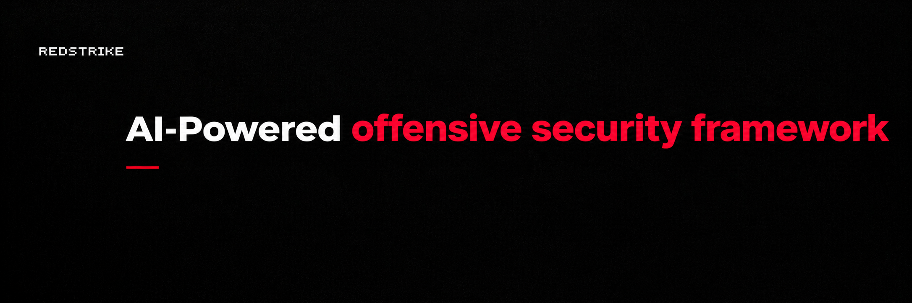
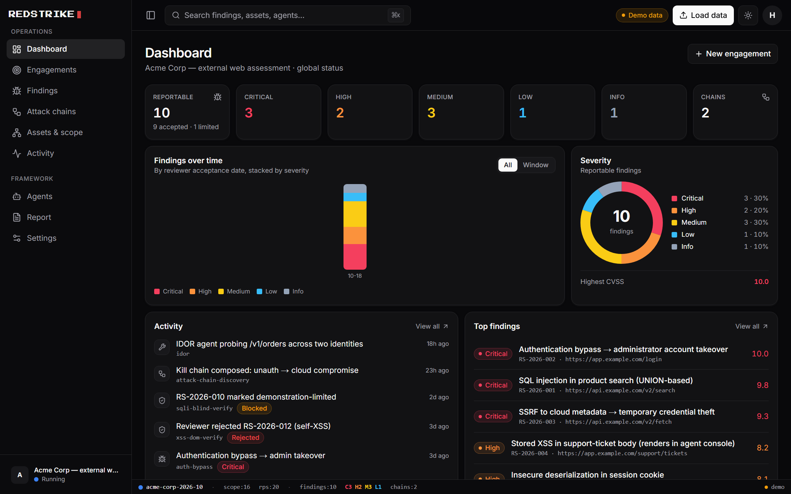
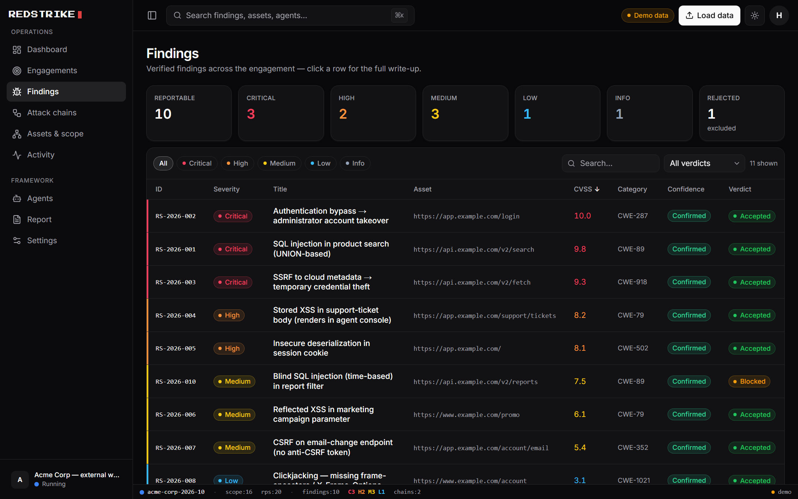
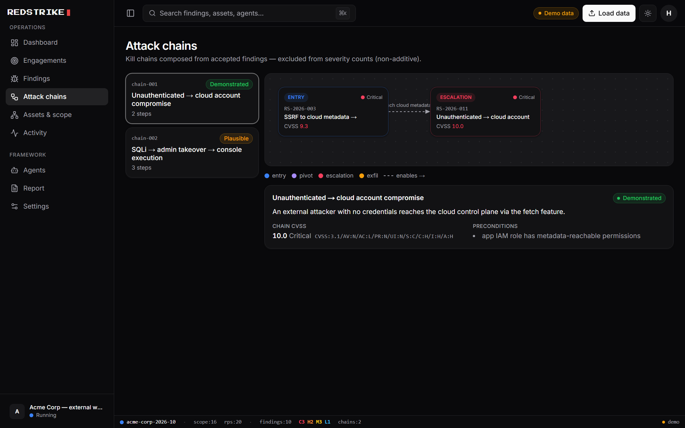
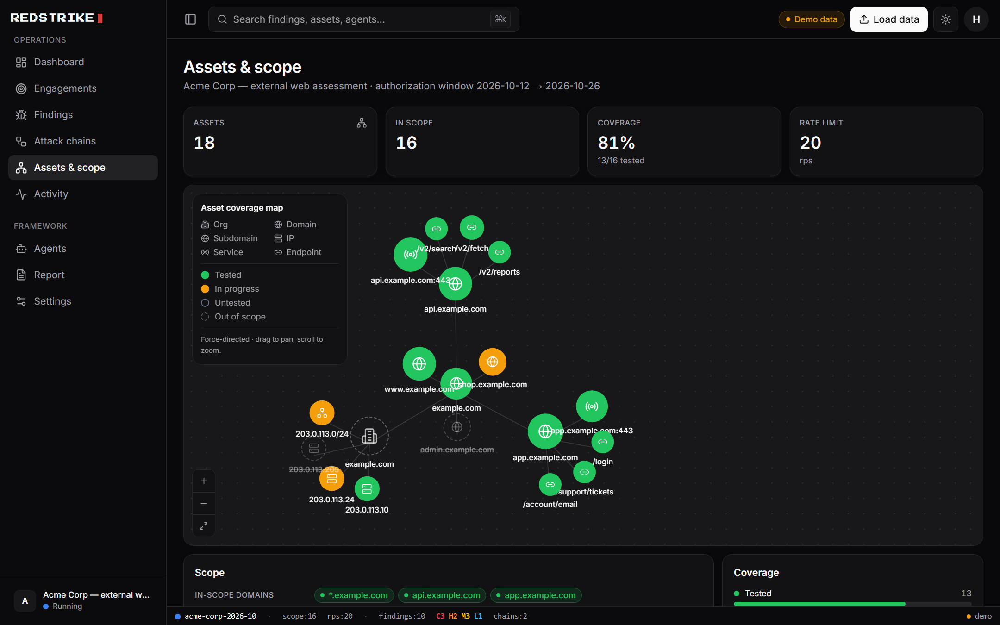
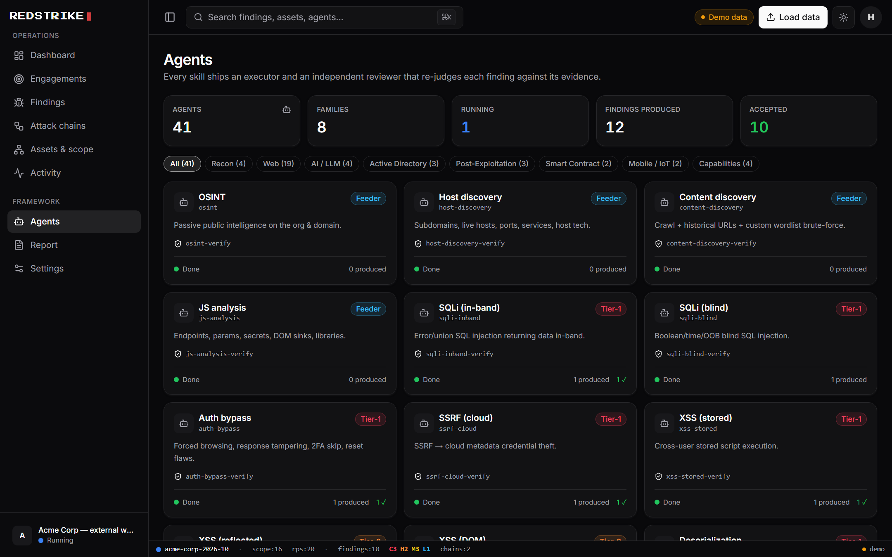
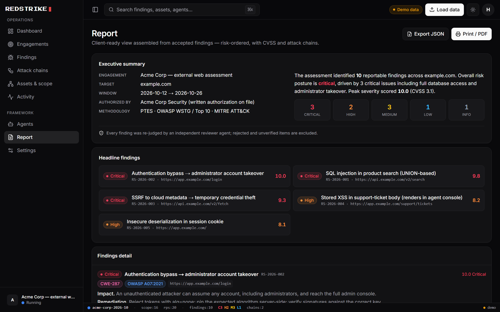
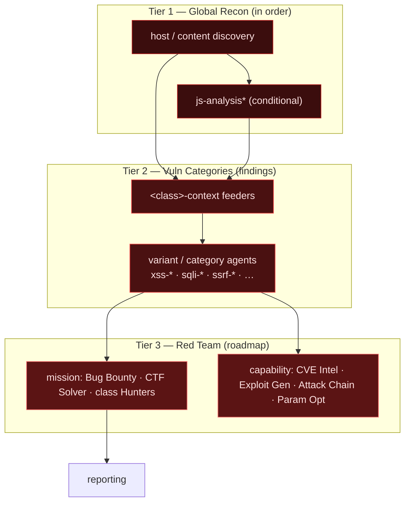

<div align="center">



Redstrike AI
============

### AI-Powered Offensive Security Framework

**A red-team of AI agents for authorized penetration testing — web, AI/LLM (OWASP LLM Top 10), Active Directory, and post-exploitation — where every skill ships a methodology checklist *and* an independent reviewer agent that verifies each finding against evidence.**

🎯 [What is it](#-what-is-redstrike-ai) • 🖥️ [Console](#️-console) • 🏗️ [Architecture](#️-architecture) • 🔁 [Two-Altitude Review](#-the-two-altitude-review) • 🧩 [Skill Contract](#-the-skill-contract) • 🤖 [Agents](#-agents--skills) • 🚀 [Quickstart](#-quickstart) • 🛡️ [Safety](#️-safety--authorization)

[]()
[](LICENSE)
[]()
[]()
[]()
[]()
[]()
[]()
[]()
[]()
[]()
[]()

</div>

---

## 🎯 What is Redstrike AI

Redstrike AI turns an offensive web-security engagement into a set of **modular AI agents that work like a real pentest team** — and, crucially, **check each other's work**.

The problem with LLM-driven offensive tooling is two failure modes: it **hallucinates vulnerabilities** (false positives that destroy client trust) and **silently skips coverage** (false negatives you never see). Redstrike's answer is a strict, uniform contract: every skill is an **executor** that follows a methodology **checklist**, a deterministic **completion gate**, and an **independent reviewer agent** that re-judges every finding against its evidence in a fresh context.

- **Methodology-grounded** — PTES engagement lifecycle · OWASP WSTG / Top 10 · MITRE ATT&CK tags.
- **Evidence-first** — no finding ships without a reproducible artifact; the reviewer rejects anything it can't verify.
- **Authorization-gated** — scope allowlist, approval gates for exploitation, audit logging, benign-PoC + cleanup rules baked in.
- **Substrate-agnostic** — runs as native **Claude Code** skills + subagents, on the Claude Agent SDK, or under its own orchestrator.

---

## 🖥️ Console

A zero-backend **web console** over the engagement data model — dark-mode, keyboard-driven, and built for an operator running a live assessment. Press <kbd>⌘K</kbd> to jump to any view, switch engagement, or open any finding; a terminal status bar keeps scope, rate limit and live severity tallies in view. It renders the same `findings_consolidated.json` / `attack_chains.json` / `scope.json` the skills emit (or starts on bundled demo data), scores CVSS 3.1 in-browser to match `scripts/cvss.py`, and keeps composite kill-chains out of the severity counts. Built with **Next.js + TypeScript + Tailwind**.

```sh
cd console && npm install && npm run dev   # → http://localhost:3000
```

<p align="center">
  
</p>

<table>
  <tr>
    <td width="50%"><br/><sub><b>Findings</b> — filter, sort, severity-coded; full write-up drawer with evidence &amp; CVSS</sub></td>
    <td width="50%"><br/><sub><b>Attack chains</b> — kill-chain graph composed from accepted findings</sub></td>
  </tr>
  <tr>
    <td width="50%"><br/><sub><b>Assets &amp; scope</b> — force-directed coverage map (tested / in-progress / out-of-scope)</sub></td>
    <td width="50%"><br/><sub><b>Agents</b> — the executor + independent-reviewer fleet, by family &amp; tier</sub></td>
  </tr>
</table>

<p align="center">
  
  <br/><sub><b>Report</b> — executive summary, risk-ordered findings, export / print</sub>
</p>

> Theme toggles light/dark; everything is monochrome chrome with color reserved for data (severity, verdict, coverage, graphs). See [`console/`](console/) for the full view list and how to load real engagement data.

---

## 🏗️ Architecture

Three tiers. Lower tiers produce typed artifacts; higher tiers consume and orchestrate them — all coordination happens through shared contracts on disk (`finding.schema.json`, `<class>_context.schema.json`, the evidence vault), never ad-hoc chatter, so the whole engagement is auditable and replayable.



- **Tier 1 — Global recon** runs once, in order (`osint → host → content → js-analysis`), and feeds everything. `js-analysis`\* (endpoints, params, secrets, DOM sinks, tech) is **downstream of host/content discovery and conditional** — skip it on JS-less / pure-API targets.
- **Tier 2 — Vuln categories** are the finding producers. **Compound** classes (XSS, SQLi, SSRF, …) decompose into a `<class>-context` feeder + one agent per variant; **atomic** classes (CSRF, open-redirect, …) are a single agent. See [`skills/_contract/vuln-catalog.md`](skills/_contract/vuln-catalog.md).
- **Tier 3 — Mission & capability agents** (the "red team") orchestrate the lower tiers. See [`skills/_contract/agent-tiers.md`](skills/_contract/agent-tiers.md).

---

## 🔁 The Two-Altitude Review

This is the core idea. **Review happens twice, at two different altitudes — do not conflate them.**

| | `review.md` — **mechanical** | `verify.md` — **semantic** |
|---|---|---|
| **Question** | Did every step run and emit well-formed output? | Is each finding real, reproducible, in-scope, correctly rated? |
| **Nature** | Deterministic — exists · non-zero · valid format · plausible size | LLM judgment, evidence → claim |
| **Runs as** | a script ([`verify_completion.py`](skills/_contract/verify_completion.py)) | a **subagent with its own fresh context** |
| **Catches** | execution false-**negatives** (silent failure, empty output) | analytical false-**positives** (hallucinated vuln) + scope/safety violations |
| **Applies to** | **every** skill | **only** findings-producing skills |

> The reviewer is an **agent, not more instructions** — on purpose. Independence is the whole point: an executor cannot trustworthily grade its own work, because it shares its own blind spots. The reviewer runs fresh, sees only the findings + evidence, and is adversarial.

---

## 🧩 The Skill Contract

Every skill is a self-contained **quad** (findings-producing skills add a 5th file):

```
<skill-name>/
  SKILL.md       # design-interview header + goal · steps · tools · I/O · phases
  checklist.md   # load-bearing completion ledger ( [ ] = re-run, [x] = done )
  review.md      # mechanical gate + an embedded JSON manifest for the verifier
  verify.md      # semantic finding gate — ONLY if the skill emits findings.json
  refs/          # RAG corpus: regexes, wordlists, payloads, good samples
```

Build order and the full spec live in [`skills/_contract/README.md`](skills/_contract/README.md). The checklist semantics are **load-bearing**: `- [ ]` is an instruction to re-run, not a note — the checklist *is* the control loop.

---

## 🤖 Agents & Skills

Each findings-producing agent is a full quint with its own independent reviewer subagent. Full statuses in [`vuln-catalog.md`](skills/_contract/vuln-catalog.md).

**Recon** (Tier 1) — `osint` (passive intel + wordlist terms) · `host-discovery` (subdomains / live hosts / ports) · `content-discovery` (crawl + brute-force + **custom wordlists**) · `js-analysis` *(gold standard)* · `source-audit` *(white-box: cross-language dangerous-sink grep → routes candidates to the vuln executors)*

**XSS family** — `xss-context` feeder → `xss-reflected` · `xss-stored` · `xss-dom` · `xss-blind`

**Atomic single agents** — `csrf` · `cors` · `open-redirect` · `clickjacking` · `host-header` · `request-smuggling` · `cache-poisoning` · `subdomain-takeover` · `security-headers` · `secrets` · `exposed-surface` · `business-logic` · `nosql-injection` · `ldap-injection` · `prototype-pollution` · `race-condition` · `parameter-pollution` · `waf-bypass` *(capability — tuned evasion ladder, feeds the vuln agents)*

**Families** ✅ (feeder + variants each) — SSRF (`inband`/`blind`/`cloud`) · SQLi (`inband`/`blind`) · access-control (`idor`/`privesc`) · injection (`ssti`/`command-injection`/`deserialization`) · XXE (`inband`/`blind`) · file/path (`path-traversal-lfi`/`upload-rce`) · auth (`auth-bypass`/`jwt`/`oauth`) · API (`bola-bfla`/`graphql`)

**AI / LLM** ✅ (OWASP LLM Top 10 2025) — `llm-context` · `agent-recon` (agent-protocol recon: MCP/A2A/OpenAPI) → `prompt-injection` (LLM01) · `sensitive-disclosure` (LLM02/07/08) · `excessive-agency` (LLM06) · `llm-output-handling` (LLM05)

**Web3 / smart contract** ✅ (OWASP Smart Contract Top 10) — `web3-context` (contracts / proxy / surface + pre-dive worth-it score) → `sc-access-control` · `sc-upgradeability` · `sc-accounting` · `sc-oracle-mev` · `sc-reentrancy` · `sc-signature` — every finding proven on a **local Foundry fork** (no live tx, no real funds)

**Active Directory** ✅ (internal / assumed-breach) — `ad-context` (BloodHound) → `ad-kerberos` · `ad-acl-abuse` · `ad-adcs` (ESC1-15) · `ad-lateral-movement`

**Post-exploitation** ✅ — `linux-privesc` (linpeas-first enumeration) · `windows-privesc` (winPEAS-first) — playbook-driven; benign-proof + cleanup

**Reporting** — `reporting` aggregates every skill's *accepted* findings into the client report (CVSS, evidence, exec summary).

**Single-class hunters** — `xss-hunter`, the first **`<class>-hunter`**: a depth-first entry point that drives one vuln family end-to-end — `bug-bounty` pinned to a single class. It *reuses* the class's `<class>-context` feeder + variants + their reviewers + packaging (a thin wrapper, never a fork), so new hunters (`sqli-hunter`, `ssrf-hunter`, …) are ~30-line clones over [`hunter-base.md`](skills/_contract/hunter-base.md).

Under **Claude Code** these are wired as runnable primitives in [`.claude/`](.claude/): executor **skills** (`redstrike-*`) + reviewer **subagents** (`*-verify`) + the **`redstrike`** orchestrator. See [`.claude/README.md`](.claude/README.md).

---

## 🚀 Quickstart

Redstrike runs natively in **Claude Code** (skills + subagents are discovered from `.claude/` at session start).

**Start a full pentest in plain English** — open the repo in Claude Code and just say what you want. The `redstrike` orchestrator **confirms authorization + scope first**, then runs the whole flow (OSINT → host/content discovery → JS analysis → vuln-category agents, each gated by its reviewer → chaining → report):

> *"I'm a security researcher and pentester. My company owns the website `https://example.com` and I would like to conduct a penetration test against it."*

> *"Run a full web pentest on `app.example.com` — we're authorized, in-scope is `*.example.com`."*

> *"Assess `https://example.com` for vulnerabilities and give me a report."*

```bash
git clone https://github.com/0xnookie/redstrike-ai.git
cd redstrike-ai
# open in Claude Code, then either say one of the prompts above, or drive pieces directly:
#   /redstrike            → the orchestrator (authorization + scope → recon → vuln agents → reviewers → report)
#   /redstrike-js-analysis, /redstrike-xss-reflected, …  → run a single skill
```

Run the deterministic completion gate on any skill's output:

```bash
python skills/_contract/verify_completion.py --skill skills/xss-reflected --out engagements/<client>/xss-reflected
# exit 0 = PASS · exit 2 = re-run the failed steps
```

Validate the whole framework (what CI runs):

```bash
python scripts/validate.py
```

---

## 🖥️ The `redstrike` CLI

Prefer a command you launch over an in-chat prompt? The **`redstrike` CLI** (in [`cli/`](cli/)) runs
**Claude Code as the engine** — it bootstraps an engagement, enforces a scope/RoE gate, and starts
Claude Code preloaded with the skills + subagents. Interactive and human-gated by default, with an
opt-in autonomous (headless) mode.

```bash
./cli/install.sh              # one command (Linux/macOS/WSL) → global `redstrike`; needs `claude` on PATH

redstrike doctor              # preflight: engine + auth + platform + tool roster
redstrike install --core      # install the tool roster (wraps scripts/install.sh; --all or category names)
redstrike init "Acme Corp" \  # scaffold engagements/acme-corp-<date>/ + scope.yaml + an authorization record
  --authorized-by "sec@acme / written-auth-ref" \
  --domain '*.acme.com' --domain api.acme.com \
  --exclude-domain admin.acme.com \
  --i-confirm-authorization
# review the generated scope.yaml, then:
redstrike run  acme-corp-<date>              # interactive, gated (you approve exploitation)
redstrike run  acme-corp-<date> --dry-run    # print the exact argv + generated runtime/ files
redstrike run  acme-corp-<date> --autonomous --max-turns 200 --max-budget-usd 20 \
               --allow 'Bash(nmap *)'        # headless recon; un-allowed shell defers for approval
redstrike approve acme-corp-<date>           # review/approve deferred commands, then run … --resume
redstrike status acme-corp-<date>            # findings by severity/status + scope
redstrike verify acme-corp-<date>            # the deterministic completion gate
```

**How it's enforced** — a generated `runtime/settings.json` wires a **PreToolUse scope-gate hook** that
denies any tool call reaching an out-of-scope asset and blocks writes to the launcher-owned governance
files; `scope.yaml` is the signed record, `runtime/scope.json` its machine projection. Autonomous mode
runs `dontAsk` + an allowlist (deny-by-default), budget/turn-capped, MCP-isolated; shell the operator
didn't pre-allow is **deferred for approval** (`redstrike approve` → `--resume`) rather than run. The hook
is a safety net over the OS sandbox (WSL2/Linux), not a replacement. Full docs: [`cli/README.md`](cli/README.md).

---

## 🛰️ Running an Engagement

1. **Scope** — copy [`engagements/_template/scope.yaml`](engagements/_template/scope.yaml), fill authorization + in/out scope + window + RoE. Nothing active runs until scope is set.
2. **Recon** — `js-analysis` maps the surface once.
3. **Vuln categories** — the orchestrator routes targets to the right `<class>-context` feeder → variant agents, per `vuln-catalog.md`.
4. **Gate each skill** — mechanical (`review.md`) → then the finding reviewer subagent (`verify.md`). Only **accepted** findings advance.
5. **Report** — accepted findings assemble into the engagement report; everything stays in the engagement dir as the audit trail.

---

## 🛡️ Safety & Authorization

Redstrike is for **authorized** security testing only (pentest engagements, bug-bounty programs with scope, owned systems, CTFs, research).

- ✅ Scope allowlist checked before every active action (out-of-scope = hard stop)
- ✅ Human approval gates before exploitation / post-exploitation
- ✅ Benign-PoC rules + cleanup artifacts for stored/persistent/high-risk classes
- ✅ Immutable audit log (chain of custody) + kill switch
- ❌ No testing without written authorization
- ❌ No destructive actions, DoS, or data exfiltration against real users
- ❌ Engagement data (evidence, findings, client scope) is git-ignored — never committed

See [`skills/_contract/roe-gate.md`](skills/_contract/roe-gate.md).

---

## 🧰 Setup

Redstrike is **tool-first** and runs on **Kali / Debian / Parrot** (on Windows, use WSL2 + Kali). Install the
toolchain with the bundled scripts — full guide in [`INSTALL.md`](INSTALL.md):

```bash
scripts/doctor.sh          # read-only: present / missing / manual, per category
scripts/install.sh         # core set; or --all for every domain; or name categories (e.g. ad cloud)
```

The roster (168 tools across 19 categories) is defined once in
[`scripts/tools.manifest`](scripts/tools.manifest) and shared by `doctor.sh` + `install.sh`.

---

## 🗺️ Roadmap

- ✅ **All 9 vuln families complete** (XSS, SSRF, SQLi, access-control, injection, XXE, file/path, auth, API) + 11 atomic agents + the `reporting` aggregator
- ✅ **Tier-3 red team built**: Bug Bounty · CTF Solver · CVE Intelligence · Exploit Generator · Attack Chain Discovery · Parameter Optimization (the mission + capability agents that orchestrate the lower tiers)
- ✅ **Single-class hunters** — the `<class>-hunter` pattern (`hunter-base` + `xss-hunter`): `bug-bounty` pinned to one class, depth-first; future hunters are ~30-line clones of the class block
- ✅ `host-discovery` + `content-discovery` recon feeders
- ✅ **Tooling setup**: `scripts/doctor.sh` (presence check) + `scripts/install.sh` (category-scoped installer) driven by `scripts/tools.manifest` — see [`INSTALL.md`](INSTALL.md)

---

## 🧭 Standards

Redstrike aligns to industry methodology: [PTES](http://www.pentest-standard.org/), [OWASP WSTG / Top 10](https://owasp.org/www-project-web-security-testing-guide/), [OWASP LLM Top 10](https://genai.owasp.org/), and [MITRE ATT&CK](https://attack.mitre.org/).

---

## 📜 License

MIT — see [`LICENSE`](LICENSE). Use Redstrike only against systems you are explicitly authorized to test.
